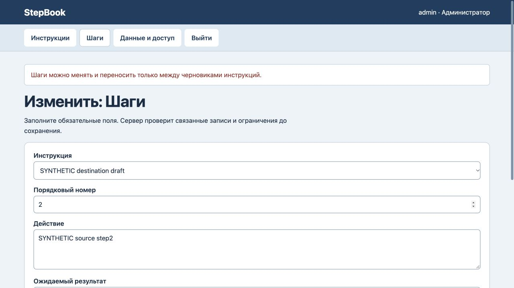
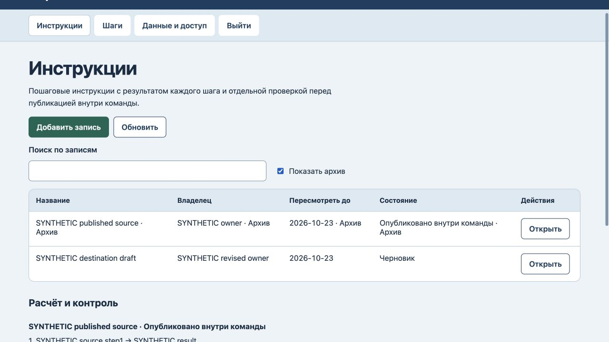

# StepBook: опубликованные шаги и срок пересмотра

25 октября2026. На прежнем коде воспроизведены два сбоя: перенос последнего шага в черновик уменьшал опубликованную инструкцию с2 шагов до1, а истёкший срок ранее опубликованной инструкции блокировал несвязанные правки и восстановление. Все3 новые регрессии сначала завершились ошибкой.

Теперь проверяются исходная инструкция и назначение переноса: оба должны быть черновиками. Шаги опубликованного источника нельзя перенести, изменить или архивировать. Отдельный возврат в черновик сохраняет редактирование. Срок по UTC проверяется при новой публикации; история не блокирует другую работу, архив и восстановление. Повторная публикация требует актуального срока и полного порядка шагов. Сохранённый исторический статус не подтверждает актуальность инструкции.

Все7 тестов прошли, включая файловый перезапуск и восстановление. Браузерный отказ переноса сохранил все данные,2 опубликованных шага/1 шаг черновика, версию6 и6 событий журнала. Правка независимого черновика сохранилась; новая просроченная публикация отклонена, статус черновика и версия7/журнал7 сохранены. Архив старой инструкции сохранил опубликованный статус, срок и все шаги, версия8/журнал8; история прочитана повторно через Показать архив. [Машинная проверка](lifecycle-verification.json).

Сервер проверен локально. Новые интеграции, размещение и клиентская приёмка не заявлены. Прежние ошибочные переносы автоматически не исправляются: нужна ручная сверка. Разметка и схема хранения не менялись; новый полный аудит интерфейса или безопасности не проводился.
